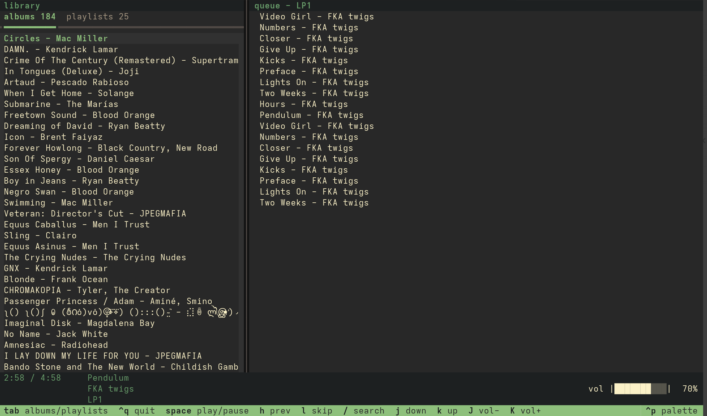

# cli-sp

A terminal-based Spotify client built with [Textual](https://github.com/Textualize/textual) and [Spotipy](https://github.com/spotipy-dev/spotipy). Requires an active Spotify Premium account.



---

## requirements

- Python 3.10+
- A Spotify Premium account
- A Spotify developer app (for API credentials)
- Have Spotify installed on your computer

---

## setup

### 1. clone the repo

```bash
git clone https://github.com/cristian-alexutan/cli-sp.git
cd cli-sp
```

### 2. install dependencies

Using a virtual environment is recommended. You can create one with:
```bash
python -m venv venv
source venv/bin/activate  # on Windows: venv\Scripts\activate
```

Then, install the required packages with:

```bash
pip install -r requirements.txt
```

### 3. create a Spotify developer app

Go to [developer.spotify.com/dashboard](https://developer.spotify.com/dashboard), create an app, add a redirect URI (e.g. `http://127.0.0.1:8888/callback`), and select Web API.

### 4. configure environment variables

Create a `.env` file in the project root, following the format of `.env.example`.

### 5. (optional) use Soloist instead of the desktop app

[Soloist](https://developer.spotify.com/documentation/soloist) is Spotify's official headless client: it runs in the background as a Spotify Connect device, with no window. If `soloist` is on your `PATH` (or in `~/.local/bin`) and `SOLOIST_API_KEY` is set in `.env`, cli-sp uses it; otherwise it falls back to the desktop app.

1. Download the build for your platform from the [Soloist downloads page](https://developer.spotify.com/documentation/soloist/reference/downloads-and-updates) and put the `soloist` binary in `~/.local/bin`.
2. Generate an API key at [developer.spotify.com/dashboard/soloist](https://developer.spotify.com/dashboard/soloist) and add it to `.env`:
   ```
   SOLOIST_API_KEY=your_soloist_key
   SPOTIFY_DEVICE_NAME=cli-sp   # optional, this is the default
   ```
3. (Linux, recommended) create `~/.config/systemd/user/soloist.service` so Soloist keeps running after cli-sp exits. cli-sp then starts it with `systemctl --user start soloist`, and copies the key into `~/.config/soloist/soloist.env` (mode 600) for the unit to read:
   ```ini
   [Service]
   EnvironmentFile=%h/.config/soloist/soloist.env
   ExecStart=%h/.local/bin/soloist -n ${SOLOIST_DEVICE_NAME} -k ${SOLOIST_API_KEY} -w 127.0.0.1:0
   Restart=on-failure
   RestartPreventExitStatus=10
   ```
   Without the unit, cli-sp spawns `soloist` directly.
4. On first run, pair it: open Spotify on any device on the same network and pick `cli-sp` from the device list. Soloist remembers the session.

Soloist builds expire 90 days after they are built. cli-sp warns you two weeks before; to update, download a new build and replace the binary.

---

## running

```bash
python -m cli-sp
```

On first run, a browser window will open asking you to authorize the app. After that, a `.cache` file will store your token locally.

---

## keybindings

| key | action |
|-----|--------|
| `space` | play / pause |
| `h` | previous track |
| `l` | skip track |
| `j` / `k` | navigate library |
| `tab` | switch between albums and playlists |
| `J` / `K` | volume down / up |
| `enter` | play selected album or playlist |
| `/` | search Spotify |
| `^q` | quit |

### search popup

| key | action |
|-----|--------|
| type | search as you type; saved albums/playlists (♥) show instantly |
| `↓` / `ctrl+j` | move from the search box into the results |
| `j` / `k` | navigate results (`k` at the top returns to the box) |
| `tab` | cycle tabs: all, tracks, albums, artists, playlists |
| `enter` | play: a track plays within its album; an artist opens their tracks and albums |
| `a` | add the selected track to the queue |
| `esc` | back out of an artist, or close search |

---

## notes

Albums play in order. Playlists play shuffled.